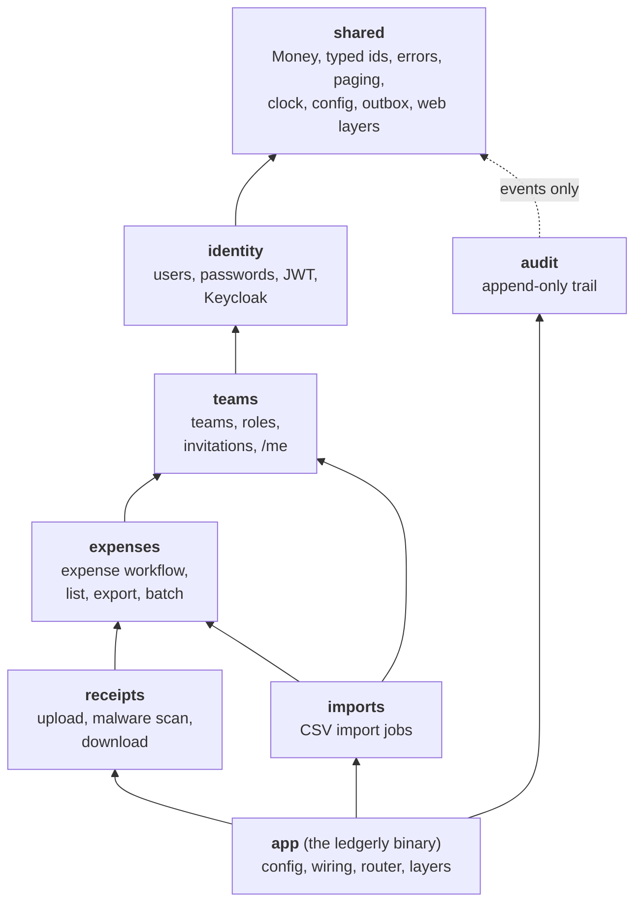
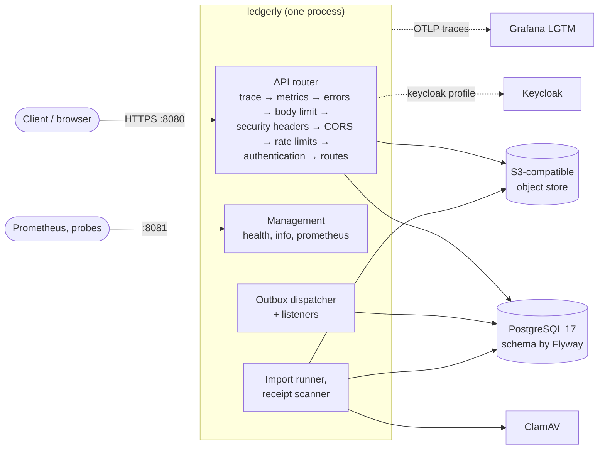

# Ledgerly-Rust

**Learn Rust backend development on a real system whose behaviour is already known.**

Ledgerly is a REST backend in which small teams record expenses, attach receipts, import CSV files and move each expense through an approval workflow. It was first written in Java with Spring Boot ([Ledgerly-Java](https://github.com/AlexisRoe/Ledgerly-Java)). This repository is its **drop-in replacement in Rust**: the same HTTP contract, database schema, configuration, operational endpoints and demo data. You can point it at a database written by the Java version and it keeps working.

> 📚 **Lessons:** a Rust course for TypeScript developers in [`learn/`](learn/index.html), see [Learning Rust with this repository](#learning-rust-with-this-repository)
> 🌐 **Live demo:** _coming soon_

---

## Contents

- [Intention](#intention)
- [Learning Rust with this repository](#learning-rust-with-this-repository)
- [Requirements](#requirements)
- [How to start](#how-to-start)
- [Important commands](#important-commands)
- [Architecture](#architecture)
- [Technologies](#technologies)
- [Folder structure](#folder-structure)
- [Scripts](#scripts)
- [Further reading](#further-reading)
- [Licence](#licence)

---

## Intention

Most Rust tutorials stop at toy programs. This project starts where they stop. It is a complete, production-grade backend: authentication, authorization, money, file uploads, malware scanning, background jobs, an audit trail, metrics, tracing and a hardened container image. **Every behaviour is pinned down by a working Java implementation** and by a black-box test suite that both versions must pass.

That makes it a good place to learn because:

- **You always know the right answer.** When you wonder "what should happen here?", the Java code, the OpenAPI contract and the parity tests tell you. You can concentrate on *how Rust does it*.
- **You see the same idea in two languages.** Exceptions become `Result`, Spring's filter chain becomes Tower layers, JPA becomes sqlx with compile-time-checked SQL, and runtime checks become types. [`docs/learning-log.md`](docs/learning-log.md) records every such translation, milestone by milestone, with links into both code bases.
- **It was built step by step.** The [implementation plan](docs/implementation-plan.md) goes from a pure domain model (M0) to a shipped container image (M11), and each step is one commit. You can check out any milestone and read how the code grew.
- **Security is designed in, not bolted on.** Typed ids, secrets that cannot be logged, team-scoped queries, rate limits, CORS, an SSRF architecture test, supply-chain checks, and no `unsafe`, `unwrap` or `panic!` outside tests.

Who it is for: developers who know a backend language (Java, Kotlin, C#, Go, TypeScript…) and want to see idiomatic Rust in a realistic code base.

## Learning Rust with this repository

[`learn/`](learn/) holds a self-paced course, **Rust for TypeScript developers**, that uses this code base as its
worked example. Every Rust idea is introduced next to its TypeScript counterpart, followed by where that comparison
breaks, and then shown in Ledgerly's own code.

### What you can learn

| Part | Sections | You'll be able to… |
| --- | --- | --- |
| **I · Reading and changing Ledgerly** (lessons 1–79) | toolbox and project setup · syntax, modules, imports, folders · data types · control flow · ownership and borrowing · functions, closures, iterators · traits and generics · error handling · macros and attributes · async · testing · serde, sqlx, axum, tracing · reading Ledgerly end to end · making changes | open any file in `crates/`, explain it, follow a request through every layer, and make small changes with the compiler's help |
| **II · Rust in depth** (lessons 80–128) | ownership and lifetimes in depth · traits in depth · concurrency and async internals · memory and performance · designing Rust code · writing macros · `unsafe`, briefly · capstone: a service from scratch | understand what's underneath (lifetimes, `Send`/`Sync`, futures and `Pin`, layout), design your own types and APIs, and build a concurrent service from `cargo new` |

Each lesson takes 10–15 minutes and has:

- recall questions on earlier lessons;
- real Ledgerly code;
- quizzes with instant feedback;
- a link to a primary source.

Around them are:

- **21 printable cheat sheets** and a glossary, in `learn/reference/`;
- **57 hands-on exercises** with solutions, in `learn/playground/`. Each exercise is a set of failing tests for you to make pass;
- **a reference solution for the capstone service**, in `learn/capstone/`.

### Using it locally

```sh
open learn/index.html            # macOS; or open the file in any browser: no server, no build step
                                 # lessons record progress in your browser's local storage

cd learn/playground              # exercises: needs only the Rust toolchain (step 2 of "How to start")
cargo test ex16                  # one lesson's exercise; the README there explains the loop

cd learn/capstone && cargo test  # the capstone's reference solution
```

When you open the pages from a clone, the file paths under code snippets open that file at that line in VS Code.
Neither the playground nor the capstone is part of the Cargo workspace, so `just check` ignores both. Docker is
only needed for the lessons that run Ledgerly's own test suite or the app.

A deployed version of the course is linked from this repository's page on GitHub, for reading without a clone.

### Publishing the website

`just learn-build` turns `learn/` into a static site in `dist/` (git-ignored), using
[`scripts/build-learn-site.py`](scripts/build-learn-site.py) and nothing but Python's standard library. `dist/` is
generated from scratch on every run, from whatever `learn/` contains: every page, stylesheet, script and image is
published at the same path, except in the Cargo projects (`playground/`, `capstone/`). New lessons, cheat sheets or
folders need no change to the script. It adds the favicons from `learn/assets/icons/`, a web manifest, a 404 page
and Cloudflare's `_headers`. It also points every link that leaves the site (the playground README, ADRs, code
captions) at GitHub, at the commit being built, so that commit must be pushed. The build fails on a broken link, on
a lesson or cheat sheet in `learn/assets/course.js` without a page, and on a linked file that isn't committed.

```sh
just learn-serve                 # build, then preview on http://localhost:8000
just learn-deploy                # build, then upload with wrangler to the Pages project `ledgerly-rust`
```

With Cloudflare Pages' Git integration instead, set the build command to `python3 scripts/build-learn-site.py` and
the output directory to `dist`. The links then use the commit Cloudflare built (`CF_PAGES_COMMIT_SHA`).

### What it was built on

- **Created:** 17 November 2026. All external resources (the Rust Book, std docs, Tokio, crate docs, articles) were
  cited and checked on that date. Later versions of those pages may differ.
- **Rust:** toolchain 1.99.1 (pinned in `rust-toolchain.toml`), edition 2024.
- **Ledgerly-Rust:** version 0.1.0, as of the completed M0–M11 implementation (commit `255db67` on `main`). Line
  numbers in lessons refer to that code; `python3 learn/check-lessons.py` reports any snippet that has drifted
  since.
- **Behaviour baseline:** Ledgerly-Java at commit `e2a1390` (see `vendor/ledgerly-java/SOURCE`).

---

## Requirements

| Tool | Why | How to get it |
| --- | --- | --- |
| [Git](https://git-scm.com) | Clone the repository | Your package manager |
| [Docker](https://www.docker.com) ([OrbStack](https://orbstack.dev) on macOS, or Docker Desktop) | Postgres, the S3-compatible object store, ClamAV, Keycloak, Grafana, Flyway, the test databases and the app image | The vendor's site |
| [mise](https://mise.jdx.dev) | Installs every other tool at the pinned version: Rust, `just`, `cargo-nextest`, `cargo-deny`, `sqlx-cli`, `cargo-cyclonedx`, Node, `pre-commit`, `gitleaks` | `brew install mise` or the [install guide](https://mise.jdx.dev/getting-started.html) |

Everything else is pinned in [`mise.toml`](mise.toml) and [`rust-toolchain.toml`](rust-toolchain.toml) (Rust 1.99, edition 2024), so your machine, CI and the container build use the same versions. You don't need Java.

**Hardware:** about 8 GB of free RAM for the full stack. On Apple Silicon, ClamAV runs under emulation, and its first start downloads virus signatures, which takes a few minutes.

---

## How to start

```sh
# 1. Download the code
git clone https://github.com/AlexisRoe/Ledgerly-Rust.git
cd Ledgerly-Rust

# 2. Install the toolchain and tools (read mise.toml first: mise runs what it says)
mise trust && mise install

# 3. Install the git hooks (secret scan and format checks before each commit)
pre-commit install

# 4. Build the image and start everything in Docker
just up
```

When `just up` returns, the app is ready:

| What | Where |
| --- | --- |
| API | http://localhost:8080/api/v1 |
| Swagger UI (`local` profile only) | http://localhost:8080/docs |
| Health, metrics (management port) | http://localhost:8081/actuator/health, `/actuator/prometheus` |
| Grafana (logs, traces, metrics) | http://localhost:3000 (admin / admin) |
| Keycloak (only for the `keycloak` profile) | http://localhost:8180 (admin / admin) |

The `local` profile fills an empty database with demo data: the team *Acme Travel* with `alice@example.com` (owner), `bob@example.com` (approver) and `carol@example.com` (member), all with the password `correct-horse-battery`. Try it:

```sh
curl -s -X POST localhost:8080/api/v1/auth/login \
  -H 'content-type: application/json' \
  -d '{"email":"alice@example.com","password":"correct-horse-battery"}'
```

Or run the whole request collection with `just api-test`, or open [`bruno/`](bruno/) in [Bruno](https://www.usebruno.com).

**A faster edit loop:** run only the dependencies in Docker and the app natively:

```sh
just deps    # Postgres, object store, ClamAV, Grafana, and the schema
just run     # cargo run with the `local` profile
```

More detail is in [`docs/local-setup.md`](docs/local-setup.md).

---

## Important commands

[`just`](https://just.systems) is the task runner; `just` on its own lists every task.

| Command | What it does |
| --- | --- |
| `just up` | Build the image and start the whole stack in Docker; returns when the app is ready |
| `just down` | Stop everything and keep the data |
| `just reset` | Remove every container and all data |
| `just flush` | Empty the database and the object store and keep the containers (fresh schema) |
| `just deps` | Start only the dependencies and apply the migrations |
| `just run` | Run the app natively against the dependencies (`local` profile) |
| `just verify` | **Everything CI checks**: drift check, format, clippy, deny, all tests, config lint, OpenAPI lint, the parity suite |
| `just check` | The same without the parity suite (faster) |
| `just test` | Unit and integration tests (`cargo nextest`, Postgres in Docker) |
| `just parity` | The black-box parity suite against freshly started app containers |
| `just api-test` | The Bruno request collection against a running `local` app |
| `just clippy` / `just fmt` | Lint (warnings are errors) / format |
| `just deny` | Advisories, licences, banned crates and sources of every dependency |
| `just sqlx-prepare` | Regenerate the offline query metadata in `.sqlx/` after changing a query (needs `just deps`) |
| `just image` | Build the container image |
| `just image-check` | Check the image as CI does: not root, no fixable high or critical vulnerability (Trivy) |
| `just sbom` | Write the binary's CycloneDX SBOM to `target/sbom/` |
| `just logs` / `just ps` | Follow the stack's logs / list its containers |

Plain cargo works too: `cargo build`, `cargo test`, `cargo run --bin ledgerly`. Builds need no database, because `SQLX_OFFLINE=true` reads the committed query metadata.

---

## Architecture

Ledgerly-Rust is a **modular monolith**: one binary, built from a Cargo workspace with one crate per business module. The compiler enforces the boundaries. A module's public API is only its facade and its events, and a test checks the crate graph against the allowed arrows ([ADR 0010](docs/adr/0010-one-crate-per-module.md)).

### Modules and their allowed dependencies



- **Commands** go through the owning module's facade; **everything else reacts to events**.
- Events are written to an outbox table **in the same transaction** as the change, and delivered after commit. Unfinished ones are delivered again after a restart.
- A module never reads another module's tables. Every query that reads team data takes the team id.

### Inside a module

```text
crates/expenses/src/
├── lib.rs          the public facade and events, nothing else
├── domain/         the aggregate and its rules: pure, synchronous, no I/O
├── application/    use cases: open a transaction, call the domain, publish events
├── persistence/    sqlx queries, always scoped to a team
└── web/            routes, request and response types, error mapping
```

### At runtime



The order of the HTTP layers copies Spring Security's filter chain, so status codes, headers and error bodies match the Java version byte for byte. The full picture is in [`CONCEPT.md`](CONCEPT.md); every decision is in [`docs/adr/`](docs/adr/).

### How correctness is proven

| Layer | What it checks |
| --- | --- |
| Unit tests | Domain rules, parsing, crypto, formats, often next to the code they test |
| Integration tests | Use cases and SQL against a real Postgres in Docker, with a clock the tests move |
| Parity suite ([`crates/parity-tests`](crates/parity-tests)) | 269 black-box HTTP tests ported from Java's test suite, run against the real container; every response is validated against the OpenAPI contract |
| Bruno collection | The shared request collection, unchanged from Java |
| Architecture tests | The crate graph, and that only infrastructure adapters may make outbound calls (SSRF) |

---

## Technologies

| Concern | Crate or tool |
| --- | --- |
| Language | Rust 1.99, edition 2024; `unsafe` forbidden in every crate |
| Async runtime | [tokio](https://tokio.rs) |
| HTTP server | [axum](https://github.com/tokio-rs/axum), [tower](https://github.com/tower-rs/tower), tower-http; routing and contract checks written by hand ([ADR 0014](docs/adr/0014-hand-written-http-layer-checked-against-the-contract.md)) |
| Database | PostgreSQL 17 with [sqlx](https://github.com/launchbadge/sqlx) (compile-time-checked queries, TLS via rustls) |
| Migrations | [Flyway](https://flywaydb.org), running the Java project's SQL unchanged |
| Money and time | `rust_decimal`, `chrono`, `uuid` (v7 ids in newtypes) |
| Serialization | `serde`, `serde_json` |
| Passwords and tokens | `argon2`, `p256` (ES256 JWTs), `ring` (identity-provider signatures), `sha2`, `subtle`, `secrecy` + `zeroize` for secrets in memory |
| Object storage | `aws-sdk-s3` against any S3-compatible store (SeaweedFS locally) |
| Malware scanning | A hand-written clamd client over TCP |
| Identity provider (optional) | Keycloak via OpenID discovery, with `hyper`, `hyper-rustls` |
| Observability | `tracing` (ECS JSON logs), OpenTelemetry (OTLP traces), `metrics` + Prometheus exporter |
| Errors | `thiserror`, mapped to RFC 9457 problem details |
| Testing | `cargo-nextest`, `proptest`, `reqwest` + `jsonschema` (parity suite), Bruno |
| Supply chain | `cargo-deny`, `cargo-auditable`, CycloneDX SBOM, Trivy, gitleaks, Renovate |
| Container | Multi-stage Dockerfile, distroless runtime (about 42 MB, non-root, read-only) |
| CI | GitHub Actions: verify, parity, image, deny, gitleaks, lints, vendor drift |

---

## Folder structure

```text
Ledgerly-Rust/
├── crates/                 the Cargo workspace
│   ├── shared/             building blocks every module uses
│   ├── identity/           accounts, login, tokens, Keycloak
│   ├── teams/              teams, memberships, invitations
│   ├── expenses/           the expense workflow, list, export, batch
│   ├── receipts/           receipt upload, scanning, download
│   ├── imports/            CSV imports
│   ├── audit/              the audit trail
│   ├── app/                the `ledgerly` binary: config, wiring, server
│   └── parity-tests/       the black-box suite shared in spirit with Java
├── api/openapi.yaml        the HTTP contract (shared with Java, read-only)
├── bruno/                  the request collection (shared with Java, read-only)
├── vendor/ledgerly-java/   migrations, realm, config and docs from Java (read-only)
├── learn/                the Rust course: lessons, cheat sheets, playground, capstone
├── docs/
│   ├── adr/                architecture decision records
│   ├── implementation-plan.md   milestones M0–M11, step by step
│   ├── learning-log.md     what each milestone taught: Java → Rust
│   ├── local-setup.md      developer setup in detail
│   ├── deployment.md       configuration, image, runbook
│   └── reference/          extracts of the Java code and tests
├── scripts/                helper scripts used by the justfile and CI
├── .sqlx/                  offline query metadata for sqlx (committed)
├── .github/workflows/      CI
├── Cargo.toml              workspace, shared lints, release profile
├── Dockerfile              the production image
├── compose.yaml            the local stack
├── justfile                every task
├── mise.toml               pinned tools
├── deny.toml               dependency policy
├── MISSION.md, CONCEPT.md, GLOSSARY.md
└── LICENSE
```

---

## Scripts

The scripts in [`scripts/`](scripts/) are called by `just` tasks and CI; you rarely run them directly.

| Script | Used by | What it does |
| --- | --- | --- |
| `parity.sh` | `just parity` | Builds the image, runs the parity suite once per configuration group, removes every container it started, and flushes the data after a passing run |
| `flush.sh` | `just flush` | Empties Postgres and the object store and rebuilds the schema; services that ran keep running |
| `image-check.sh` | `just image-check`, CI | Fails if the image runs as root or Trivy finds a fixable high or critical vulnerability |
| `wait-until-ready.sh` | `just up` | Waits for the readiness probe from outside (the image has no shell) |
| `vendor-check.sh` | `just vendor-check`, CI | Fails if a file vendored from Java was changed, added or removed |
| `upstream-report.sh` | CI (`upstream`) | Reports how far Ledgerly-Java has moved past the vendored commit |
| `gen-currencies.sh` | `just gen-currencies` | Regenerates the ISO 4217 table from OpenJDK's data |
| `gen-unicode-digits.sh` | `just gen-unicode-digits` | Regenerates the Unicode digit table Java's `BigDecimal` accepts |

---

## Further reading

| Document | What it answers |
| --- | --- |
| [`MISSION.md`](MISSION.md) | Why this repository exists and what success looks like |
| [`CONCEPT.md`](CONCEPT.md) | Architecture, security by design, testing, definition of done |
| [`GLOSSARY.md`](GLOSSARY.md) | The domain language |
| [`docs/adr/`](docs/adr/) | Every decision and why it was made |
| [`docs/implementation-plan.md`](docs/implementation-plan.md) | The build order, milestone by milestone |
| [`docs/learning-log.md`](docs/learning-log.md) | What each milestone taught: Java constructs and their Rust counterparts |
| [`learn/index.html`](learn/index.html) | The Rust course for TypeScript developers, taught on this code base |
| [`docs/local-setup.md`](docs/local-setup.md) | Everything about the developer setup |
| [`docs/deployment.md`](docs/deployment.md) | Configuration, the image, Keycloak, TLS, the runbook |
| [Ledgerly-Java](https://github.com/AlexisRoe/Ledgerly-Java) | The original, for side-by-side reading |

---

## Licence

[MIT](LICENSE) © 2026 Alexis Roehrling
